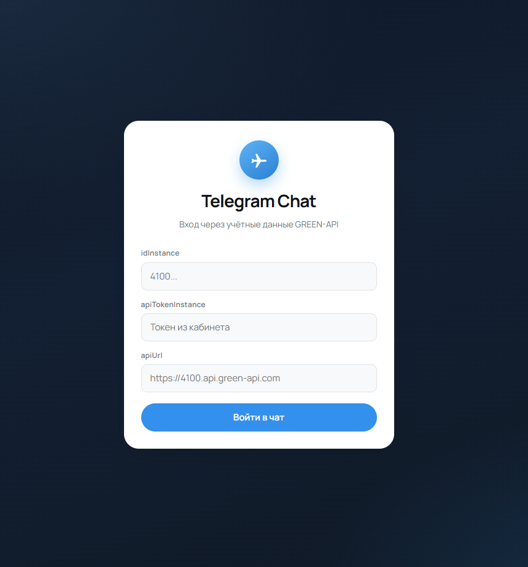
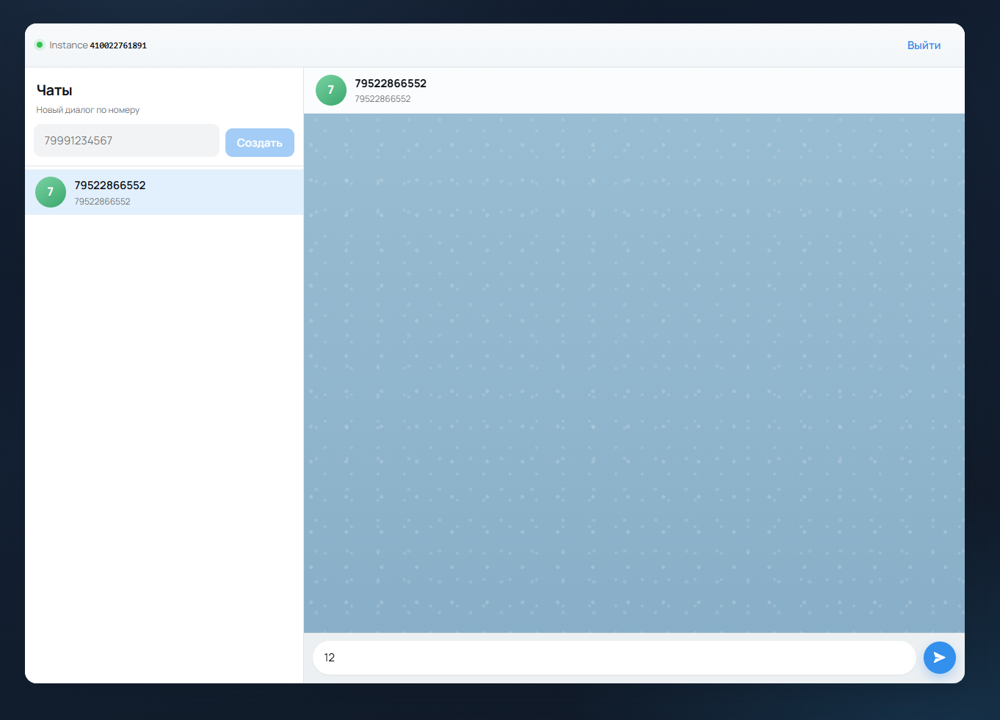

# GREEN-API Telegram Chat

Веб-чат для отправки и получения текстовых сообщений в Telegram через [GREEN-API](https://green-api.com/telegram).

## Возможности

- вход по `idInstance`, `apiTokenInstance`, `apiUrl`
- создание чата по номеру телефона
- отправка текстовых сообщений (`SendMessage`)
- получение входящих сообщений через HTTP API (`ReceiveNotification` + `DeleteNotification`)

## Стек

- React 19
- TypeScript
- Vite
- Feature-Sliced Design

## Структура

```
src/
  app/        # провайдеры, глобальные стили, точка сборки
  pages/      # страница чата
  widgets/    # auth-panel, chat-sidebar, chat-window
  features/   # auth, create-chat, send-message, receive-messages
  entities/   # session, chat, message
  shared/     # API-клиент, UI-кит, конфиг
```

## Запуск

```bash
npm install
npm run dev
```

Сборка:

```bash
npm run build
npm run preview
```

## Настройка GREEN-API

1. Зарегистрируйтесь в [личном кабинете GREEN-API](https://green-api.com/telegram).
2. Создайте инстанс для Telegram и авторизуйте его.
3. Скопируйте из кабинета:
   - `apiUrl`
   - `idInstance`
   - `apiTokenInstance`
4. Для получения сообщений через HTTP API:
   - оставьте пустым `webhookUrl`
   - включите входящие уведомления (`incomingWebhook`)

Документация:

- [SendMessage](https://green-api.com/en/telegram/docs/api/sending/SendMessage/)
- [Получение через HTTP API](https://green-api.com/en/telegram/docs/api/receiving/technology-http-api/)
- [Перед началом работы](https://green-api.com/en/telegram/docs/before-start/)

## Как пользоваться

1. Откройте приложение и введите `idInstance`, `apiTokenInstance`, `apiUrl`.
2. Создайте чат по номеру телефона получателя (международный формат, например `79991234567`).
3. Отправьте текстовое сообщение.
4. Ответ из Telegram появится в чате автоматически (long-poll).

## Скриншоты



## Демо

[https://siega52.github.io/green-api/](https://siega52.github.io/green-api/)
